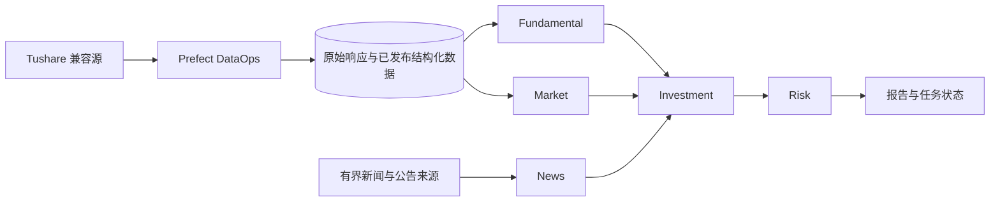

# A 股 DataOps 与五角色投研 PRD

文档版本：当前范围基线，2026-11-22。文档改写状态：**待验收**。本 PRD 描述项目当前交付范围和仍需核验的边界；代码、数据覆盖和评测结果以实际运行证据为准。[plan.md](plan.md) 的顶部当前范围决议保持不变，旧 Step 里程碑仅作历史背景。

## 1. 产品定位与边界

面向个人投资者的沪深 A 股**单股票**研究工作台。DataOps 先采集、处理并发布可信的结构化数据；Fundamental、News、Market 分别调查基本面、近期信息和技术面，Investment 综合分析，Risk 终审风险。用户可提交任务、查看状态与报告、取消任务，并看到已知的数据缺口。

当前研究入口只接收交易所限定证券代码或准确名称 `target`，以及可选研究时点 `as_of`。程序解析唯一证券后运行固定职责的五角色链路；它不接收任意研究问题，不执行多股票比较。`as_of` 未提供时取当前上海时间。研究是信息分析，不执行交易，也不假设用户持仓。

当前范围**不包含**独立快问答、文档上传解析、RAG/向量知识库、图表页面、观察列表与告警、独立文本源监控、实时/分钟行情、自由补查循环或运行时最终 Verify。已有的历史数据库迁移不因功能收敛而回滚，持久化数据不作破坏性清理。

## 2. 用户与使用流程

| 用户 | 当前任务 |
| --- | --- |
| 投研用户 | 提交一只 A 股的研究，查看进度、五角色产物、最终报告和限制，按需取消 |
| 数据管理员 | 配置数据源、执行回填/增量/重扫/补数，查看数据质量、水位及发布状态 |
| 系统管理员 | 管理访问边界，查看服务、研究任务、模型调用和数据管道状态 |

三个专业角色并行；Investment 等待三者产物，Risk 等待 Investment。五个角色的产物和调用记录按任务关联。角色失败或来源不可用时保留已知结果、缺口和降级原因，不把缺失内容当作事实。

## 3. DataOps 数据底座

### 3.1 数据范围

| 数据域 | 当前职责 |
| --- | --- |
| 证券与日历 | 交易所限定代码、名称、上市状态、交易日；名称歧义不自动猜测 |
| 行情与估值 | 日 OHLCV、复权因子、估值及技术指标；保留价格和交易日期口径 |
| 财务与基本面 | 三张报表、公司档案、盈利、资产负债、现金流和辅助基本面；保留报告期、披露时点与修订版本 |
| 公司行为与行业 | 分红和行业关系及其来源、有效期和覆盖状态 |
| 原始与质量层 | 原始响应、哈希、标准化版本、质量问题、发布状态、窗口水位、失败批次与补数记录 |

`company_key_metrics` 的 PE-TTM 使用过去十二个月滚动净利润口径的已发布估值数据；静态 PB 使用估值交易日价格与最新已披露财报时点的 BPS，二者由 DataOps 按版本写入供基本面工具读取。缺少估值、价格或 BPS 时记录缺口，不临时编造数值。

### 3.2 数据规则

1. 数据处理顺序为**采集 → 原始留存 → 标准化 → 质量检查 → 发布 → 消费与补数**。只对本次实际取得、可追溯且符合发布规则的数据给出对应覆盖状态。
2. 统一证券代码、单位、金额和股数；原值与标准值并存。`null`、未披露、源错误、权限不足和过期须区分，空值不转换成零。
3. 财务流量区分年度、累计、单季与 TTM；资产负债等时点值不做累计转单季。派生值保留公式、输入和版本，历史 `as_of` 不读取当时尚未可用的修订。
4. 回填、收盘后更新、财报修订重扫、技术指标计算和失败批次重放应幂等且有界。水位、任务、质量和失败原因可查询；源或权限失败不得静默标为完成。
5. 结构化 DataOps 主要经 Tushare 兼容提供方取得；接口权限、证券覆盖、历史窗口和准确性按实际探测记录，不由积分或接口名推断已覆盖全市场。

Prefect 调度 DataOps；PostgreSQL/TimescaleDB 保存业务数据、任务和时间序列，原始响应保留在持久化存储中。研究任务使用 Redis 队列、数据库状态和节点检查点。供应商地址与 Token 由环境配置，不能写入源码或报告。

## 4. 五角色研究

| 角色 | 可用工具 | 必须完成的工作 |
| --- | --- | --- |
| Fundamental（基本面） | `get_company_profile`、`get_profitability`、`get_balance_sheet`、`get_cash_flow` | 基于已发布公司、盈利、资产负债和现金流记录形成 Markdown 分析，说明期间、单位、覆盖和限制 |
| News（新闻与公告） | `get_stock_news`、`get_announcements`、`get_earnings_events` | 只分析近七个自然日、每工具最多十条的实际结果；区分公告、媒体信息、空窗口和来源失败 |
| Market（市场与技术面） | `get_stock_data`、`get_indicators` | 先取得最多六十根已发布日线，再读最近三十个完整交易日的指标；技术信号仅作条件性观察 |
| Investment（投资分析） | 无外部工具 | 读取三个专业角色产物，形成有条件的投资初评、依据、限制和观察或行动条件 |
| Risk（风险终审） | 无外部工具 | 复核上游证据、投资初评、重要风险及数据缺口，形成最终风险审查和评级说明 |

工具调用由程序约束证券代码、研究时点、允许的参数和角色权限。工具结果包含可追溯 Evidence 与覆盖信息；分析推断应标明依据和不确定性，不能把推断或情景假设写成已披露事实。News 的近期来源使用已接入的有界提供方接口，不声称长期新闻归档完整。Investment、Risk 不能依靠模型记忆补充不存在于输入的证券事实。

研究任务有 `request_id`、`task_id`、阶段、状态和事件；节点检查点保存已完成角色的结果。取消和恢复沿用任务状态与检查点，重复执行不得无故重复已完成角色的业务结果。任务可能为 `queued`、`running`、`partial`、`failed` 或 `cancelled`；角色降级与工具缺口需保留原因。

## 5. 报告与验证状态

当前链路将 Investment 和 Risk 的 Markdown 汇入研究报告，保留五角色审计记录和工具结果。**没有执行最终数值、引用及语义 Verify，也没有报告修正回环**；运行时代码将验证状态标为跳过或待核实，报告状态固定为 `partial`。`partial` 可以表示已有研究产物，不等于事实和结论已通过核验。

报告中若出现来源失败、数据覆盖不足或角色失败，应明确披露，不能声称数据完整、结论已验证或“无风险”。未来若要增加报告级 Verify，需要另行确认迭代范围，定义证据清单、关键事实、失败原因码和最终状态门禁，不以当前评测数据代替运行时核验。

## 6. API、前端和运维

| 入口 | 当前用途 |
| --- | --- |
| `POST /api/v1/analysis/query` | 提交唯一证券的五角色研究，接收 `target` 和可选 `as_of` |
| `GET /api/v1/analysis/research/{task_id}` | 读取任务、事件、角色产物、报告和验证状态 |
| `POST /api/v1/analysis/research/{task_id}/cancel` | 请求取消 |
| `/api/v1/data/*`、`/api/v1/fundamental/*` | 查询已发布结构化数据、基本面记录与状态 |
| `/health/live`、`/health/ready`、`/metrics` | 服务、依赖与运行指标 |

前端为 React/TypeScript 简易研究工作台：输入一只股票、提交、手动刷新、取消并显示任务 JSON。独立五角色视图、证据浏览和自动刷新尚未交付。FastAPI 提供认证及任务所有权边界；研究 Worker、Prefect Worker、数据库、Redis、Prometheus/Grafana 由 Compose 支撑。模型调用元数据可按任务关联，缺少 Token 用量或价格时费用不应记为零。

当前默认配置的整次深度研究预算为 300 秒、50,000 个模型输入加输出 Token；每角色配置 120 秒、16,000 Token。**Fundamental 和 Market 的专用执行路径尚未直接执行角色级超时与累计 Token 硬门禁**，因而这些配置不能写作五角色均已严格保证的上限。实际性能与成本须在固定配置下测量。

## 7. 评测与交付判断

[五角色 20 条单股票评测集](backend/evals/FIVE_AGENT_20.md)覆盖 20 只不同候选股票，当前只完成用例和评分规则。正式评测前须完成对应 DataOps、冻结 `as_of`、保存九个工具的实际输出及版本、标注并复核关键事实。未标注用例不得进入质量分母；不能从题目数量推断准确率。

核心维度为任务完成、关键事实与数值、证据支持、时点正确、五角色传递、风险与不确定性。伪造 Evidence ID、影响结论的重大数值错误、未来信息和风险终审缺失却呈现“低风险”是严重错误；空结果被正确披露时不自动判失败。工具轨迹、重复运行稳定性、延迟、Token 与成本另行报告。当前没有已完成的 20 题真实评分，也不能宣称多 Agent 优于单 Agent。

本轮交付判断依据：五角色入口与九个工具可用；DataOps 采集、发布、缺口和恢复有针对性开发检查；研究任务状态、取消和检查点恢复可检查；未核实结果不标记为 `verified`。这些是项目判断规则，**不表示本 PRD 或代码已自动验收通过**。验收只在用户主动发起时执行并记录。
